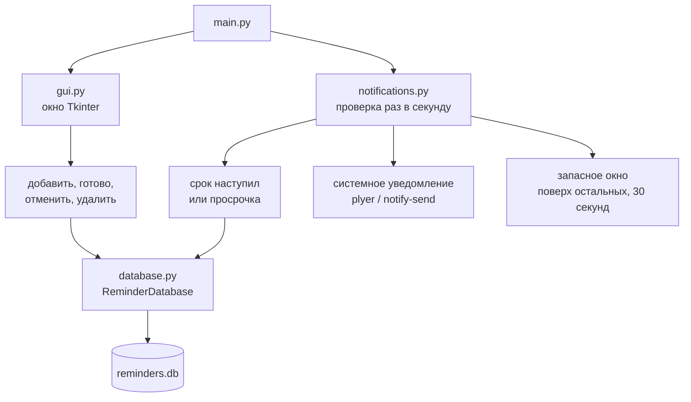

# Напоминалка

Настольное приложение для Kali Linux: одноразовые и повторяющиеся напоминания. Список хранится в SQLite. В срок приходит системное уведомление, а если оно недоступно — окно поверх остальных.

## Схема



`main.py` собирает базу, уведомления и окно. Форма пишет напоминания в `reminders.db`. Фоновая проверка раз в секунду читает ту же базу: сначала показывает системное уведомление, а если оно недоступно — окно Tkinter. После показа запись становится «Готово»; для повтора создаётся следующая.

## Структура

| Файл | Назначение |
| --- | --- |
| `main.py` | Точка входа: база, уведомления и окно |
| `database.py` | Класс `ReminderDatabase`, файл `reminders.db` |
| `notifications.py` | Класс `NotificationManager`, проверка раз в секунду |
| `gui.py` | Окно Tkinter |
| `requirements.txt` | Зависимость `plyer` |

`tkinter` и `sqlite3` входят в Python. База `reminders.db` создаётся при первом запуске и в git не попадает. Туда же не попадают `.env` и каталог `venv`.

## Установка

Нужен Python 3.14: пакет `python3-tk` в Kali ставится именно для него. Для системных уведомлений нужна команда `notify-send`.

```bash
sudo apt install python3-tk libnotify-bin
python3.14 -m venv venv
source venv/bin/activate
pip install -r requirements.txt
```

Если модуль `venv` для Python 3.14 недоступен, окружение можно собрать через `uv`:

```bash
uv venv venv --python /usr/bin/python3.14
source venv/bin/activate
uv pip install -r requirements.txt
```

## Запуск

```bash
source venv/bin/activate
python main.py
```

## Как пользоваться

В форме укажите название, описание, дату, время и повтор. Кнопка **Добавить** сохраняет напоминание.

Кнопки срока только подставляют дату и время, запись сами не создают:

- **5 мин**
- **15 мин**
- **30 мин**
- **1 час**

**Тест уведомления** проверяет показ, не добавляя запись.

Фильтры списка:

- **Все**
- **Ожидает**
- **Ближайшие** — статус «Ожидает» и срабатывание в ближайший час
- **Просрочено**
- **Готово**
- **Отменено**

Двойной щелчок по строке открывает детали. **Готово** завершает выбранное напоминание. Если задан повтор, создаётся следующее со статусом «Ожидает». **Отменить** останавливает серию и следующее не создаёт. **Удалить** убирает запись. **Обновить** перечитывает список.

При закрытии окна появляется вопрос «Вы уверены, что хотите выйти?».

## Статусы и повтор

Статусы в базе: «Ожидает», «Готово», «Просрочено», «Отменено».

Повтор: без повтора, каждый день, каждую неделю, каждый месяц. Если день вроде 31-го не существует в следующем месяце, срок ставится на последний день этого месяца.

Пока программа запущена, база проверяется каждую секунду. В нужный момент напоминание показывается через системное уведомление. Если оно не сработало, открывается окно поверх остальных: оно в фокусе и закрывается через 30 секунд или кнопкой **Закрыть**. После показа статус становится «Готово». Если время вышло больше чем на минуту и напоминание не было показано, статус становится «Просрочено».
